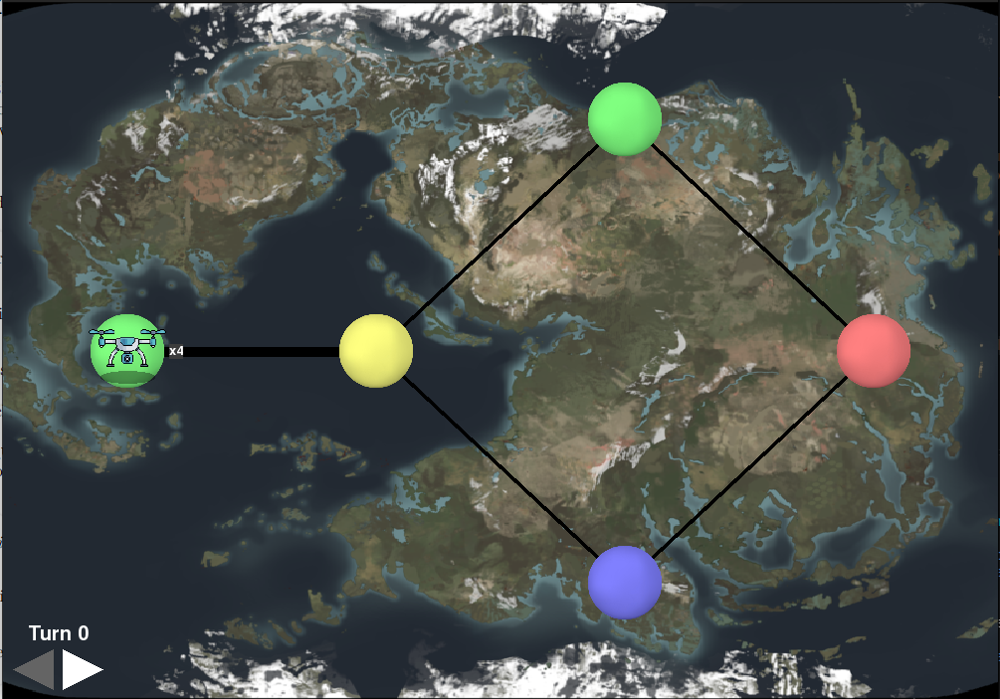

_This project has been created as part of the 42 curriculum by ikolokou._

# Fly-In

## Description

Fly-In is a project where in a map (graph) drones need to travel to the end by finding the most optimal path and at the same time respecting any limitations found in the connections (edges) or hubs (nodes).

## Instructions

1. In terminal, run `make install` to create a new virtual environment and inside install the dependencies needed.
2. Run `make run ARGS=<file path>` to start the simulation. `file path` is the txt file that holds all map specifications. Here is an example of such a file:
```txt
# Easy Level 2: Simple fork with two paths
nb_drones: 4

start_hub: start 0 0 [color=green]
hub: junction 1 0 [color=yellow max_drones=2]
hub: path_a 2 1 [color=blue]
hub: path_b 2 -1 [color=green]
end_hub: goal 3 0 [color=red]

connection: start-junction [max_link_capacity=2]
connection: junction-path_a
connection: junction-path_b
connection: path_a-goal
connection: path_b-goal
```
Optional:

- Run `make debug` to go into debugging mode.
- Run `make clean` to remove any `__pycache__` and ` `.mypy_cache`. 
- Run `make lint` to check py files with flake8 and mypy.
- Run `make lint strict` for a stricter version of the mypy. Note that most likely the files do not meet these standards as it is optional by the project specs.
- I can send you a benchmark py file to check the benchmarks. It's not submitted, because it does not contrubute to the functionality of the program.

## txt file format

The txt file needs to meet certain requirements:

- **One entry per line**, written as `key: value`. The valid keys are `nb_drones`, `start_hub`, `end_hub`, `hub` and `connection`. Any other key is rejected.
- **Case-insensitive**: the whole file is lowercased before parsing.
- **Comments** start with `#`. They can take up a full line or follow an entry. Empty lines are ignored.
- **`nb_drones`** is mandatory and appears once. It takes a single integer ≥ 1.
- **`start_hub`** and **`end_hub`** are mandatory and each appears exactly once. They use the same syntax as `hub`.
- **`hub: <name> <x> <y> [metadata]`** declares a hub. `hub` lines can repeat.
  - `name` must be unique and cannot be empty or contain dashes (`-`) or spaces.
  - `x` is an integer ≥ 0. `y` is any integer.
- **`connection: <name1>-<name2> [metadata]`** declares a bidirectional link between two hubs.
  - At least one connection is required.
  - Both names must be declared as hubs.
  - A connection can't be declared twice. `a-b` and `b-a` count as the same connection.
- **Metadata** is optional:
  - It goes in a single pair of square brackets at the end of the line.
  - It is written as space-separated `key=value` pairs with no spaces around `=`.
  - Each key may appear only once per line.

  | Metadata key        | Applies to  | Values                                          | Default  |
  |---------------------|-------------|-------------------------------------------------|----------|
  | `zone`              | hubs        | `normal`, `blocked`, `restricted`, `priority`   | `normal` |
  | `color`             | hubs        | any color name                                  | none     |
  | `max_drones`        | hubs        | integer ≥ 1                                     | `1`      |
  | `max_link_capacity` | connections | integer ≥ 1 (the only key allowed on connections) | `1`    |

  - `blocked` hubs cannot be entered.
  - Entering a `restricted` hub costs 2 turns instead of 1.
  - `priority` hubs are preferred when paths are otherwise equal in cost.
  - `max_drones` is ignored for `start_hub` and `end_hub`, which have unlimited capacity.
- **Start and end must be connected**: there has to be a path from `start_hub` to `end_hub`.

## Resources

- [Dijkstra's Algorithm](https://www.geeksforgeeks.org/dsa/dijkstras-shortest-path-algorithm-greedy-algo-7/)
- [pygame Docs](https://www.pygame.org/docs/)

AI has been used mostly as a guide. That means I used it to help me figure out any blocks without it giving me away the answer, but with investigative questions to help me figure out the correct solution to my problem. It also helped me figure out pygame, since it was something completely new and opened up to me the possibilities with it.

## Algorithm Choices

I chose Dijkstra's algorithm for pathfinding, becuase it seemed to me it'd be the most optimal in this case. A* algorithms are generally faster, but in graphs it would have been very easy to pick some point which normally would be closer to the end, but this point would easily lead to a trap and there wouldn't have been a clear path to continue onwards.

On the scheduling, I came up with my own solution. I'm running Dijkstra's algorithm for each drone and then pick the next step for each if it exists. If not, then the drone stays put and waits for the next turn.

This is a rather greedy approach and maybe not the most optimal in this case. Ideally I would find each optimal path for each drone and assign it this path from the start.

## Visual Representation

The simulation has a visual component created with pygame:


The arrows in the down-left corner can be pressed with the mouse to go to the next or previous turn. Left goes to a previous turn, while right goes to a next turn. You can also interact with the turns by pressing the left and right arrow keys in the keyboard.

By pressing the x top right or ESC, you quit the simulation.

You can hover the mouse on the hubs to reveal its name.

For a neater visual, if there are more than 2 drones in a hub, you see one drone with a number (e.g. 'x4') to reveal how many drones are actually there.

The thickness of the connections reveal the capacity they hold. The thicker, the more drones can traverse this connection.

If a hub had zone defined as 'restricted', then the drone waits one turn on the connection and then visits the hub.

## Example case

The following input:
```txt
# Easy Level 2: Simple fork with two paths
nb_drones: 4

start_hub: start 0 0 [color=green]
hub: junction 1 0 [color=yellow max_drones=2]
hub: path_a 2 1 [color=blue]
hub: path_b 2 -1 [color=green]
end_hub: goal 3 0 [color=red]

connection: start-junction [max_link_capacity=2]
connection: junction-path_a
connection: junction-path_b
connection: path_a-goal
connection: path_b-goal
```

produces the following visual:


But also you can get a turn-by-turn output in terminal:
```bash
=====================================================
D1-junction D2-junction 
D1-path_a D2-path_b D3-junction D4-junction 
D1-goal D2-goal D3-path_a D4-path_b 
D3-goal D4-goal 
=====================================================
```
